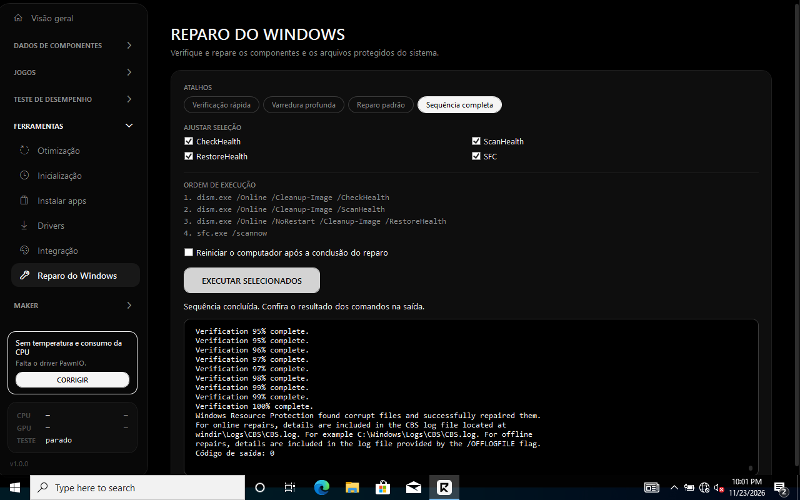

# Otimizador

Veja o que está usando os recursos do seu computador, teste o desempenho e use as ferramentas de manutenção do Windows em um só programa.

## Baixar e instalar

**[Baixar o Otimizador 1.0.0 para Windows x64](https://github.com/IsaacZimm/diagnostico-e-manutencao/releases/download/v1.0.0/Otimizador-1.0.0-windows-x64-setup.exe)**

O instalador é para computadores Intel ou AMD com Windows 11 x64 ou uma edição do Windows 10 x64 compatível com o .NET 10. Testamos a instalação, a abertura e o reparo completo no Windows 10 22H2 e no Windows 11 24H2 em máquinas virtuais. [Versões do Windows compatíveis com o .NET](https://learn.microsoft.com/pt-br/dotnet/core/install/windows#supported-versions)

1. Clique no link acima e abra o arquivo `Otimizador-1.0.0-windows-x64-setup.exe` na pasta **Downloads**. Se estiver na [página da versão](https://github.com/IsaacZimm/diagnostico-e-manutencao/releases/tag/v1.0.0), procure esse mesmo arquivo em **Assets** (arquivos para baixar). Se já tiver o Otimizador aberto, feche-o antes de instalar.
2. Confira o nome do arquivo e a origem do download. O Windows pede permissão de administrador para instalar e pode informar que o fornecedor é desconhecido, pois o instalador é distribuído sem assinatura digital.
3. Clique em **Instalar** e, ao terminar, em **Concluir**. Abra o menu **Iniciar**, digite **Otimizador** e selecione o aplicativo. O Windows pede permissão de administrador novamente ao abrir.

O programa já traz o **.NET 10 Desktop Runtime**, que é o componente de que ele precisa para abrir. Os arquivos **Source code** e o **SDK do .NET** são para quem quer trabalhar no código-fonte.

## Por onde começar

Na tela **Visão geral**, veja a memória em uso, o espaço no disco e as leituras disponíveis do processador e da placa de vídeo. Depois, use o menu à esquerda para abrir a ferramenta certa.

| O que quero fazer | Onde clicar | O que vou ver ou fazer |
| --- | --- | --- |
| Entender por que o PC está lento | **Visão geral** e depois **Ferramentas → Inicialização** | Veja o uso dos componentes e quais programas abrem junto com o Windows. |
| Conferir as peças do computador ou o espaço livre | **Dados de componentes → Sistema** ou **Discos** | Veja o modelo do processador, a memória instalada e o espaço livre em cada unidade. |
| Investigar travamentos na internet ou no Wi-Fi | **Dados de componentes → Rede → Testar** | Meça a velocidade da conexão, o tempo de resposta e a perda de pacotes. |
| Medir o desempenho do PC | **Teste de desempenho → Benchmark** | Escolha um teste de processador, placa de vídeo, memória ou disco. Um benchmark mede o desempenho com uma tarefa padronizada. Use as mesmas opções para comparar resultados. |
| Verificar se o Windows tem problemas nos arquivos do sistema | **Ferramentas → Reparo do Windows** | Escolha entre consultar a integridade do sistema, fazer uma varredura ou tentar um reparo. |
| Liberar memória ou ajustar opções para jogos | **Ferramentas → Otimização** | Veja a memória em uso, selecione os programas que quer fechar e ajuste opções como Modo de Jogo e plano de energia. Salve seu trabalho antes de fechar programas. Use **Restaurar originais** para desfazer os ajustes do Windows feitos nessa tela. |
| Acompanhar o desempenho em um jogo | **Jogos → Overlay** | Mostre informações como FPS (quadros por segundo) e temperaturas por cima do jogo, quando a captura e os sensores estiverem disponíveis. |
| Identificar um Arduino ou ESP32 conectado | **Maker → Portas COM** | Veja o número da porta que o Windows atribuiu à placa. Para consultar drivers, abra **Maker → Drivers seriais**. |

A [descrição completa da versão 1.0.0](https://github.com/IsaacZimm/diagnostico-e-manutencao/releases/tag/v1.0.0) também explica os testes de estresse, o verificador de estabilidade, os recursos de jogos, a instalação de aplicativos, o backup de drivers e o controle de iluminação.

## Como verificar e reparar o Windows

1. No menu à esquerda, abra **Ferramentas → Reparo do Windows**.
2. Escolha o atalho de acordo com o que precisa fazer.

   - **Verificação rápida** consulta se o Windows já registrou um problema na sua imagem do sistema.
   - **Varredura profunda** procura problemas no repositório de componentes, que é a base que o Windows usa para manutenção.
   - **Reparo padrão** tenta corrigir o repositório e depois verifica e repara os arquivos protegidos do sistema.
   - **Sequência completa** executa as quatro etapas na ordem exibida. Você também pode marcar ou desmarcar cada etapa individualmente.

3. Confira a lista e clique em **Executar selecionados**. Aguarde o término e leia a mensagem abaixo do botão. O código de saída `0` indica que o comando terminou sem erro. Se uma etapa falhar, anote o nome da etapa e o código mostrado.
4. Se quiser reiniciar ao fim de um reparo, salve seu trabalho e marque a opção de reinicialização **antes** de executar. Ao concluir, o Otimizador dá **30 segundos para cancelar**.



*Exemplo em uma máquina de teste. O resultado e o idioma da saída acompanham o Windows instalado.*

<details>
<summary>Ver os comandos que o Otimizador executa</summary>

1. `dism.exe /Online /Cleanup-Image /CheckHealth` consulta se a imagem do Windows já foi marcada como corrompida.
2. `dism.exe /Online /Cleanup-Image /ScanHealth` verifica o repositório de componentes.
3. `dism.exe /Online /NoRestart /Cleanup-Image /RestoreHealth` tenta reparar o repositório. O Windows pode buscar arquivos de reparo pelo Windows Update.
4. `sfc.exe /scannow` verifica e tenta reparar os arquivos protegidos do sistema.

[Documentação do DISM](https://learn.microsoft.com/pt-br/windows-hardware/manufacture/desktop/repair-a-windows-image?view=windows-11) · [Suporte do SFC](https://support.microsoft.com/pt-br/windows/experience/backup-recovery/using-system-file-checker-in-windows)

</details>

## Dúvidas comuns

- **Como sei se meu computador é x64?** Abra **Configurações → Sistema → Sobre** no Windows. Em **Tipo de sistema**, procure por **processador baseado em x64** e **sistema operacional de 64 bits**. [Ajuda da Microsoft](https://support.microsoft.com/pt-br/windows/experience/compatibility/32-bit-and-64-bit-windows-frequently-asked-questions)
- **Por que não aparece a temperatura do processador?** Algumas leituras precisam de hardware compatível e do driver **PawnIO**. Se o programa mostrar o aviso de sensor, o botão **Corrigir** oferece o caminho para instalar o driver. [Página oficial do PawnIO](https://pawnio.eu/)
- **Por que não consigo usar Instalar apps?** Esse catálogo utiliza o **WinGet**, que faz parte do **Instalador de Aplicativo** da Microsoft. [Como obter o WinGet](https://learn.microsoft.com/pt-br/windows/package-manager/winget/)
- **Como removo o programa?** Feche o Otimizador e abra **Configurações → Aplicativos**. No Windows 11, entre em **Aplicativos instalados**. No Windows 10, entre em **Aplicativos e recursos**. Procure **Otimizador** e escolha **Desinstalar**. [Ajuda da Microsoft](https://support.microsoft.com/pt-br/windows/apps/uninstall-or-remove-apps-and-programs-in-windows)
<details>
<summary>Como conferir se o instalador baixado está íntegro</summary>

Baixe o arquivo `.sha256` da [página da versão](https://github.com/IsaacZimm/diagnostico-e-manutencao/releases/tag/v1.0.0) e abra-o no Bloco de Notas. Se o instalador estiver na pasta **Downloads**, abra o PowerShell e rode o comando abaixo. O valor da coluna **Hash** deve ser igual ao código no Bloco de Notas.

```powershell
Get-FileHash -Algorithm SHA256 -LiteralPath "$env:USERPROFILE\Downloads\Otimizador-1.0.0-windows-x64-setup.exe"
```

</details>

## Compilar a partir do código-fonte

Instale o **SDK do .NET 10** no Windows:

```powershell
winget install --id Microsoft.DotNet.SDK.10 --exact --source winget
```

Reabra o PowerShell, navegue até a raiz do repositório e rode:

```powershell
dotnet build Otimizador.sln -c Release
```

O SDK já inclui o runtime de desktop. Para executar um build dependente de framework em outro computador, instale o desktop runtime com `winget install --id Microsoft.DotNet.DesktopRuntime.10 --exact --source winget`. [Instalação do .NET no Windows](https://learn.microsoft.com/pt-br/dotnet/core/install/windows#install-with-windows-package-manager-winget)

### Gerar o instalador

Com o SDK instalado, instale o NSIS e execute o script no PowerShell:

```powershell
winget install --id NSIS.NSIS --exact --source winget
.\installer\compilar.ps1
```

O script publica o aplicativo para `win-x64` com o runtime incluso e gera `artifacts/v1.0.0/Otimizador-1.0.0-windows-x64-setup.exe` e o arquivo `.sha256`. Para apontar para outra instalação do NSIS, passe `-NsisCompiler` com o caminho do `makensis.exe`.

## Código e versões anteriores

O Otimizador usa código do projeto [ResetExplode, de GustavoReset](https://github.com/GustavoReset/ResetExplode), sob licença MIT. Consulte [LICENSE](LICENSE), [THIRD-PARTY-NOTICES.txt](THIRD-PARTY-NOTICES.txt) e a pasta [licenses](licenses). O código da versão anterior do **Diagnóstico e Manutenção** está na [tag v0.8.0](https://github.com/IsaacZimm/diagnostico-e-manutencao/tree/v0.8.0).
